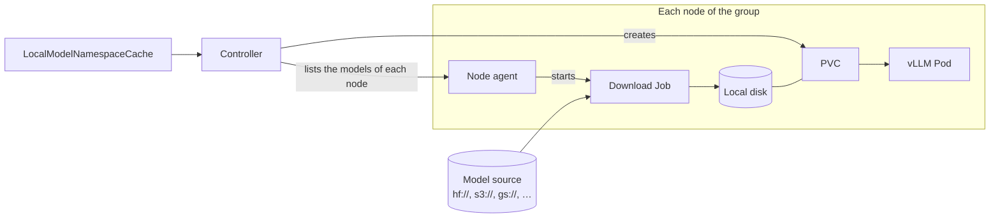

# LocalModelCache

[](https://github.com/talt5/localmodelcache/releases)
[](https://github.com/talt5/localmodelcache/actions/workflows/go.yml)
[](LICENSE)

**Keep models and compiled GPU kernels on the nodes that use them, so that inference Pods start fast.**

LocalModelCache works with any workload that can mount a PVC, such as a vLLM Deployment or your own
server. It does not serve models itself.

- **Model cache:** downloads a model once to every node of a group, and gives Pods a PVC to mount.
- **Shared storage:** or imports it once into a ReadWriteMany PVC of yours.
- **Kernel cache:** captures what a Deployment compiled, such as vLLM's `torch.compile` cache, as an OCI
  image and mounts it into its later Pods.
- **OpenShift and air-gapped clusters:** SecurityContextConstraints are included, and each release has an
  offline bundle.



## Quick start

You need [cert-manager](https://cert-manager.io), and a host path on the nodes that
[the agent can write to](docs/install.md#requirements).

- **OpenShift:** add [these flags](docs/install.md#openshift), and set the `path` in the sample to
  `/var/mnt/models`.
- **v0.2.0 from GHCR:** add [two more flags](docs/install.md#helm).

```sh
# Install
helm upgrade -i localmodelcache-crd charts/localmodelcache-crd -n localmodelcache --create-namespace
helm upgrade -i localmodelcache charts/localmodelcache -n localmodelcache

# Choose the nodes that store models
kubectl label node <node> local.cache.ai/node=worker

# Cache a model and serve it with vLLM
kubectl create namespace inference
kubectl apply -f docs/samples/vllm-node-local.yaml

# Follow the download. Until it is complete, vLLM can fail and restart.
kubectl get localmodelnamespacecache qwen3 -n inference -o jsonpath='{.status.copies}'
```

A workload then mounts the model like any other volume:

```yaml
volumes:
  - name: model
    persistentVolumeClaim:
      claimName: qwen3-gpu   # <cache>-<node group>
      readOnly: true
```

## Documentation

| Guide | Covers |
| --- | --- |
| [Install](docs/install.md) | Helm, OpenShift, air-gapped clusters, settings |
| [Model cache](docs/model-cache.md) | Node groups, mounting, shared PVCs, credentials, teams |
| [Kernel cache](docs/kernel-cache.md) | Turning it on, opting in Deployments |
| [Upgrade](docs/upgrade.md) | Moving between versions |
| [Development](docs/development.md) | Building, testing, releasing |
| [Samples](docs/samples) | Manifests to copy |
| [Helm values](charts/localmodelcache/README.md) | Every value of the chart |

## Resources

The API group is `local.cache.ai/v1alpha1`.

| Resource | Scope | What it does |
| --- | --- | --- |
| `LocalModelNodeGroup` | cluster | A set of nodes, and the local volume on each of them, that holds cached models. |
| `LocalModelCache` | cluster | Downloads a model to every node of its node groups. |
| `LocalModelNamespaceCache` | namespace | Downloads a model to the nodes of its node groups, or into a ReadWriteMany PVC you provide, and gives workloads in its namespace a PVC to mount. |
| `ClusterStorageContainer` | cluster | Replaces the container that downloads models from a given URI scheme. |
| `KernelCacheNodeGroup` | cluster | The nodes that get kernel cache images. |
| `KernelCache`, `KernelCacheCapture` | namespace | A captured kernel cache, and the capture that produced it. The controller creates them. |

The controller also keeps a `LocalModelNode` and a `KernelCacheNode` for the nodes that these use.

## Project

LocalModelCache is a fork of [KServe](https://github.com/kserve/kserve) trimmed to its model-management
features, with no InferenceService or LLMInferenceService. Both can run on one cluster.

[Contributing](CONTRIBUTING.md) · [Security](SECURITY.md) · [License](LICENSE) · [Notice](NOTICE)
